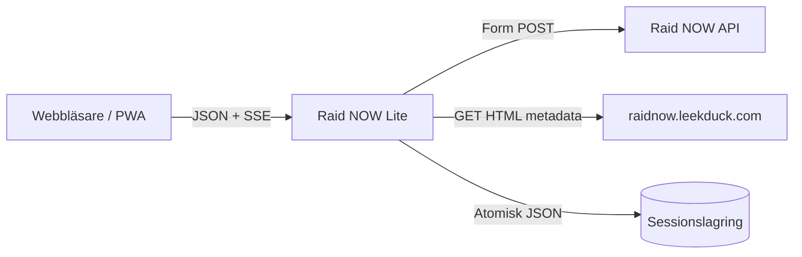
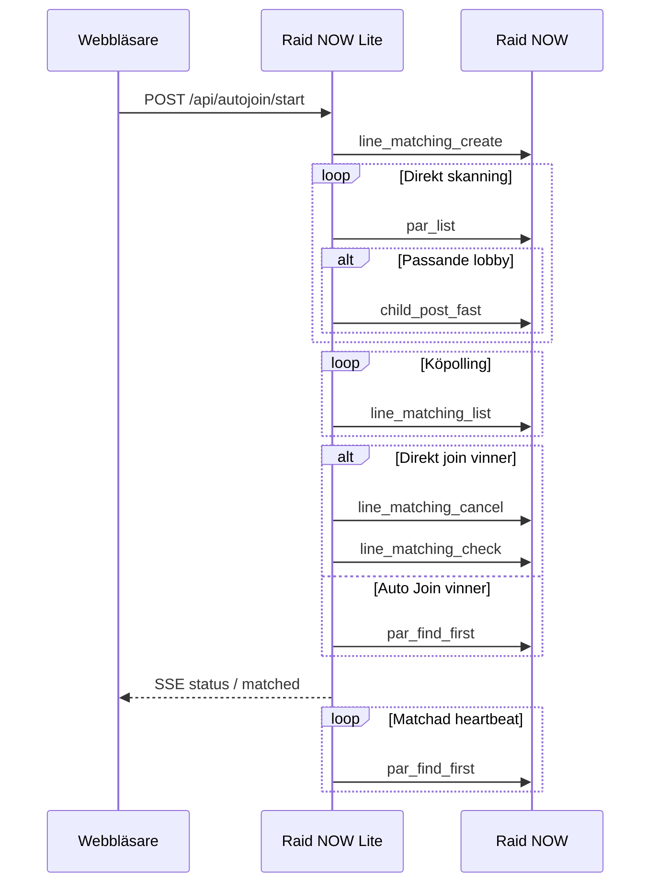

# Raid NOW-integration och API-kontrakt

Det här dokumentet beskriver hur Raid NOW Lite kommunicerar med Raid NOW, vilka
upstream-operationer som används, vilka lokala HTTP-rutter som exponeras och hur
köer, raidmedlemskap och osäkra skrivningar hanteras.

> [!WARNING]
> Raid NOWs API är odokumenterat och ägs inte av Raid NOW Lite. Fältnamn,
> svarstyper och beteenden är härledda från den nuvarande webbklienten och kan
> ändras utan förvarning. Projektet är inte anslutet till Raid NOW, Leek Duck,
> Niantic eller The Pokémon Company.

## Översikt

Raid NOW Lite består av tre huvudsakliga lager:

1. Webbläsaren anropar Raid NOW Lites lokala API.
2. Node-processen äger en separat session, token, state machine och worker per
   webbläsarsession.
3. `RaidNowAdapter` översätter worker-operationer till Raid NOWs formulärbaserade
   upstream-anrop.



Den normala sökstrategin är alltid **hybrid**:

- en vanlig Auto Join-kö skapas med `line_matching_create`;
- samtidigt skannas passande lobbyer via `par_list`;
- en direkt träff ansluts med `child_post_fast`;
- om den direkta vägen vinner avbryts Auto Join-kön och resultatet verifieras;
- om Auto Join-kön vinner stoppas den direkta skanningen.

## Upstream-transport

### Adresser

| Användning | Adress |
|---|---|
| Formuläroperationer | `https://pokemongo-get.com/wp-content/themes/simplicity2-child/include/gofriend_enraid_masta.php?v=2025121601` |
| Inloggning | `https://raidnow.leekduck.com/` |
| Pokémonmetadata | `https://raidnow.leekduck.com/` |

### Gemensamma egenskaper

Alla upstream-operationer utom metadatahämtningen skickas med `POST` och:

- `Content-Type: application/x-www-form-urlencoded; charset=UTF-8`;
- fältet `type=<operation>`;
- arrayfält som upprepade `field[]`-värden;
- `Origin: https://raidnow.leekduck.com`;
- `Referer: https://raidnow.leekduck.com/`;
- en browserliknande `User-Agent`;
- valfri `X-CSRF-Token` när `RAIDNOW_CSRF_TOKEN` är konfigurerad.

Ett tokenfält skickas där upstream-kontraktet kräver det. Ett tomt token är ett
giltigt anonymt läge för bland annat bosskatalogen. Tokens, lösenord, cookies och
trainer codes får aldrig skrivas till logg eller returneras från det lokala API:t.

### Svar och tidsgränser

- HTTP-status utanför `2xx` ger ett fel.
- Tom svarskropp är ett fel, förutom för `user_info_post` där tom `200` är giltigt.
- Icke-JSON är ett fel för alla formuläroperationer.
- Feltexter som indikerar utgången session eller krav på inloggning klassificeras
  som autentiseringsfel (`401`).
- Caller-abort och timeout avbryter även den underliggande fetch-operationen.
- En timeout på en muterande operation betyder **okänt resultat**, inte att
  operationen säkert misslyckades.

## Upstream-operationer

### Sammanfattning

| Operation | Adaptermetod | Typ | Timeout | Syfte |
|---|---|---:|---:|---|
| `login` | `login()` | Autentisering | 15 s | Logga in och erhålla ett sessionstoken |
| `user_info_post` | `updateProfile()` | Skrivning | 15 s | Uppdatera trainerprofil hos Raid NOW |
| `line_matching_get_list` | `listCurrentRaidBosses()` | Läsning | 10 s | Hämta exakt bossutbud och köaktivitet för Auto Join |
| `par_list` | `listRaids()` | Läsning | 10 s | Hämta aktiva lobbyer för direkt skanning |
| `line_matching_create` | `createMatching()` | Skrivning | 15 s | Skapa en Auto Join-köpost |
| `line_matching_list` | `pollMatching()` | Läsning | 10 s | Polla Auto Join efter matchning |
| `line_matching_check` | `checkMatching()` | Läsning | 10 s | Kontrollera om en köpost fortfarande finns |
| `line_matching_cancel` | `cancelMatching()` | Skrivning | 15 s | Begära borttagning av Auto Join-köpost |
| `child_post_fast` | `joinRaidFast()` | Skrivning | 15 s | Gå med direkt i en vald lobby |
| `par_find_first` | `findRaid()` | Läsning | 10 s | Hämta raid och verifiera medlemskap |
| `child_list` | `listRaidPlayers()` | Läsning | 10 s | Hämta spelarna i den aktiva raiden |
| `guest_raid_del_post` | `leaveRaid()` | Skrivning | 15 s | Lämna en raid som gäst |
| HTML `aryPokemon` | `#listPokemonMetadata()` | Läsning | 10 s | Hämta engelska namn och bilder |

Skrivoperationer kräver `RAIDNOW_LIVE_WRITES=true`, med undantag för själva
inloggningen. Att en skrivning är spärrad lokalt innebär inte att läsoperationer
eller bosskatalogen slutar fungera.

### `login`

**URL:** Raid NOWs startsida  
**Payload:**

- `input_email`
- `input_password1`
- `token`

Vid lyckad inloggning förväntas bland annat `status="success"` och ett `token`.
Upstream kan också returnera trainer name, level, trainer code och country code.
Lösenordet används endast för det aktuella anropet och sparas inte. Token sparas
separat för den aktuella webbläsarsessionen och returneras aldrig till frontend.

### `user_info_post`

Uppdaterar profilen som Raid NOW använder för kö och raidanslutning.

**Payload:**

- `input_tid` – trainer name
- `input_level` – trainer level
- `input_code` – trainer code
- `input_country_code` – landkod
- `token`

Detta är den enda operation där ett tomt HTTP 200-svar uttryckligen accepteras.

### `line_matching_get_list`

Hämtar den kompletta listan över bossar som för närvarande kan väljas i Raid
NOWs Auto Join.

**Payload:** `token`

Viktiga svarsfält:

- `rank` – upstreams tier/rank;
- `pokemon` – exakt upstream-ID/formnamn;
- `offpokemon` – antal spelare i Auto Join-kön.

Raid NOW Lite:

- ignorerar ofullständiga poster och `pokemon=egg`;
- bevarar exakt Pokémon-ID så olika former inte blandas ihop;
- normaliserar `offpokemon` till `waitingCount`;
- kompletterar med engelskt namn och bild från `aryPokemon`.

Resultatet används också för att skapa exkluderingslistan till `par_list` och
cachas lokalt i 60 sekunder.

### Metadata från `aryPokemon`

Raid NOWs startsida hämtas med `GET`. Raid NOW Lite läser JavaScript-variabeln
`aryPokemon`, vars poster innehåller bland annat:

- `en` – engelskt visningsnamn;
- `image` – bildadress;
- nyckeln – exakt upstream-ID för Pokémon/formen.

Metadata cachas i en timme. Ett vanligt metadatafel får inte stoppa katalogen;
upstream-ID:t används då som visningsnamn och bilden lämnas tom. Ett uttryckligt
caller-abort propageras däremot.

### `par_list`

Hämtar aktiva lobbyer för den direkta delen av hybridsökningen.

**Payload:**

- `possible=false`
- `filter[]` – Pokémon-ID:n som ska exkluderas
- `page`
- `firstaccess=0`
- `searchrank`
- `hostevalstar=""`
- `guestevalstar=""`
- `lang=1`
- `token`
- `hostlevel`
- `hostevaluate[]`

Raid NOW Lite skickar alla ej valda boss-ID:n som `filter[]`. En enda vald rank
skickas som `searchrank`; flera ranker blir `0`. Därefter gör state machinen
ytterligare lokal filtrering av bland annat:

- Pokémon och rank;
- borttagna lobbyer;
- lobbyer som redan tillhör användaren;
- hostens level och rating;
- hostens land;
- weather boost;
- gästens tillåtna level;
- lobbyer i en kort retry-cooldown.

### `line_matching_create`

Skapar den vanliga Auto Join-köposten.

**Payload:**

- `rank[]`, `pokemon[]`
- `code`, `tid`, `level`, `country_code`
- `priority`
- `lang=1`
- `gscore`
- `plugs` som JSON
- `host_country`
- `weather_boost`
- `guest6`
- `regional_raid=0`
- `token`
- `hosteval[]`
- `hosttl`

En lyckad respons gör att kön lokalt markeras som `present`. Timeout, abort eller
bruten anslutning kan ha inträffat efter att upstream tog emot skrivningen. Kön
markeras därför som `unknown` och kontrolleras med `line_matching_check`.

### `line_matching_list`

Pollar den normala Auto Join-kön.

**Payload:**

- `rank[]`
- `pokemon[]`
- `guestevalstar`
- `token`

Tolkning:

- `rpllm_status=1` – fortfarande väntande;
- `rpllm_status=2` och `rpllm_rpl_id` – matchad.

Efter matchning hämtas raidens aktuella data med `par_find_first`.

### `line_matching_check`

Kontrollerar om en Auto Join-köpost fortfarande existerar upstream.

**Payload:**

- `pokemon[]`
- `token`

Ett icke-tomt `id` betyder att kön fortfarande finns. Ett tomt eller saknat `id`
betyder att kön är borta. Operationen används:

- efter osäker `line_matching_create`;
- efter osäker `line_matching_cancel`;
- efter varje rapporterad lyckad cancellation.

### `line_matching_cancel`

Begär att Auto Join-köposten tas bort.

**Payload:**

- `lang=1`
- `token`

Ett lyckat svar räknas inte ensamt som bevis på att kön är borta. Raid NOW Lite
kör därefter `line_matching_check`. Vid fel eller timeout behålls den osäkra
köstatusen och kontrollen återförsöks från det persistenta worker-läget.

### `child_post_fast`

Ansluter direkt till en vald lobby.

**Payload:**

- `parid` – raid-ID
- `tid` – trainer name
- `level`
- `country_code`
- `show=0`
- `color=0`
- `memo=""`
- `lang=1`
- `regional_raid=0`
- `token`

Ett lyckat svar förväntas innehålla den matchade raiden i `data`. En timeout eller
avbruten anslutning kan betyda att användaren faktiskt hann anslutas. Lite går då
över till konservativ raidreconciliation i stället för att omedelbart söka igen.

### `par_find_first`

Hämtar en viss raid och används för att verifiera medlemskap.

**Payload:**

- `possible=false`
- tom `filter[]`
- `firstaccess=<raid-ID>`
- `lang=1`
- `token`
- `hostlevel=0`
- tom `hostevaluate[]`

Ett giltigt array-/listsvar där raid-ID:t saknas betyder att raiden är borta. Ett
malformat svar får aldrig feltolkas som frånvaro. Varje raidpost måste därför vara
ett objekt med ett icke-tomt `rpl_id`.

`join` används för medlemskapskontroll:

- `join=1` – medlemskapet är fortfarande aktivt;
- `join=0` – medlemskapet är uttryckligen borta;
- saknat eller tvetydigt värde – behåll lokalt läge och försök igen.

En matchad raid återvalideras normalt var 60:e sekund. Läsfel ger exponentiell
backoff upp till fem minuter. När Raid NOW uttryckligen bekräftar frånvaro rensas
den lokala matchningen. Samma operation används efter osäker join/leave och när
ett sparat matchat läge återställs efter processomstart.

### `child_list`

Hämtar spelarinformation för den aktiva raiden.

**Payload:**

- `parid`
- `lang=1`
- `token`

Svaret normaliseras till:

```json
{
  "players": [
    {
      "id": "upstream player id",
      "trainerName": "Trainer",
      "level": 50,
      "countryCode": "se",
      "rating": 5,
      "ready": 1,
      "isMe": false
    }
  ],
  "count": 4,
  "readyCount": 2,
  "raidDeleted": false
}
```

Normaliseringsregler:

- `evaluatescore_guest=-1` är en giltig rating `0`;
- heltal `1..5` bevaras;
- tom primärrating kan falla tillbaka till `pc_raid_evaluate_score_guest`;
- ogiltiga värden blir `null`;
- `rplc_country_code` har företräde;
- utan landkod mappas exakt språk `0` till `jp` och `1` till `world`;
- tomt, blankt, `null` eller okänt språk blir ingen landkod;
- `my=1` blir `isMe=true`.

### `guest_raid_del_post`

Lämnar en raid som gäst.

**Payload:**

- `edit=<raid-ID>`
- `lang=1`
- `token`

Svar som uttryckligen betyder "redan borta" behandlas idempotent som lyckade.
Vid timeout eller tvetydigt resultat markeras raidmedlemskapet som okänt och
kontrolleras med `par_find_first`. En definitiv avvisning behåller den matchade
raiden och visar felet i stället för att felaktigt låsa upp en ny sökning.

## Lokal HTTP-API

Raid NOW Lites API använder JSON, förutom SSE-rutten. Alla `/api/*`-svar har
`Cache-Control: no-store`. Stateful-rutter isoleras med en slumpmässig cookie:

- `HttpOnly`
- `SameSite=Strict`
- `Path=/`
- valfri `Secure` bakom betrodd HTTPS

### Stateless-rutter

| Metod och sökväg | Svar | Session skapas |
|---|---|---:|
| `GET /api/health` | `{"ok":true}` | Nej |
| `GET /api/push/config` | Publik pushkonfiguration | Nej |

### Session, profil och konfiguration

| Metod och sökväg | Syfte | Upstream |
|---|---|---|
| `GET /api/profile` | Läsa eventuell äldre serverprofil; normalt `{}` i multi-session-läge | Ingen |
| `PUT /api/profile` | Validera och uppdatera trainerprofil | `user_info_post` |
| `POST /api/login` | Valfri Raid NOW-inloggning | `login` |
| `POST /api/session/import` | Importera token till aktuell browsersession utan att echoa det | Ingen direkt request |
| `POST /api/session/reset` | Radera en säker, inaktiv lokal session | Ingen |
| `GET /api/config` | Läsa mode, write-flagga, pollintervall och tokenstatus | Ingen |

`PUT /api/profile` tar emot:

```json
{
  "trainerName": "Trainer",
  "trainerCode": "123456789012",
  "level": 50,
  "countryCode": "se"
}
```

Profilen kräver minst tre ASCII-tecken i trainer name, exakt tolv siffror i
trainer code, level `1..80` och en landkod. I multi-session-läge sparas den
permanenta profilen i webbläsarens `localStorage`; servern behåller den endast när
den behövs för aktiv eller återställningsbar worker-state.

`POST /api/session/reset` gör inga upstream-cancellations. Den tillåts därför
bara när sessionen inte har aktivt eller osäkert arbete, öppna SSE-klienter,
restore lock eller väntande pushleverans.

### Katalog

#### `GET /api/raids`

Queryparametrar:

- `rank=0` – alla ranker;
- annan rank – filtrera bosskatalogen;
- `page` – endast för legacy/fallback-vägen.

Normalt svar:

```json
{
  "raids": [],
  "bosses": [
    {
      "rank": "5",
      "pokemon": "upstream form id",
      "displayName": "English name",
      "image": "https://...",
      "waitingCount": 12
    }
  ],
  "fetchedAt": "ISO timestamp"
}
```

Normal live-väg använder `line_matching_get_list` tillsammans med `aryPokemon`.
Bosskatalogen kan läsas anonymt.

### Auto Join

| Metod och sökväg | Syfte |
|---|---|
| `GET /api/autojoin/status` | Aktuellt publikt worker-läge |
| `POST /api/autojoin/start` | Starta den fasta hybridsökningen |
| `POST /api/autojoin/stop` | Stoppa sökning och säkert städa köstatus |
| `POST /api/autojoin/abandon` | Nödfall: släpp en lokalt fastnad, okänd kö |

#### Startrequest

```json
{
  "profile": {
    "trainerName": "Trainer",
    "trainerCode": "123456789012",
    "level": 50,
    "countryCode": "se"
  },
  "ranks": ["5"],
  "pokemon": ["exact upstream id"],
  "hostRating": 3,
  "hostCountry": 0,
  "weatherBoost": 0,
  "hostLevel": 0
}
```

Normalisering och gränser:

- strategin tvingas till `hybrid`;
- minst en rank och ett Pokémon-ID krävs;
- ranker och Pokémon-ID:n trimmas, dedupliceras och begränsas i antal/längd;
- `hostRating`: `-1..5`, standard `3`;
- `hostCountry`: `0|1`, standard `0`;
- `weatherBoost`: `0|1|2`, standard `0`;
- `hostLevel`: `0|40|50|60|70`, där `0` betyder TL 5+;
- `hostEvaluate` härleds på servern och klientens motsvarande fält ignoreras;
- `guest6` tvingas till `0`.

Start tillåts endast från ett verkligt fritt `idle`, `stopped` eller terminalt
`error`. Att en UI-status ser avslutad ut räcker inte om det fortfarande finns en
kö, raid, operation, timer eller restore lock.

#### Statusfält

`GET /api/autojoin/status` och SSE-status kan innehålla:

- `state`
- `startedAt`, `lastContactAt`
- `nextPollAt`, `nextRetryAt`
- `error`, `lastError`, `retryCount`
- `selection`
- `raid`
- `queueCancelPending`
- `canAbandonLocal`
- `directScanDisabled`

Vanliga statusvärden är `idle`, `starting`, `searching`, `retrying`, `joining`,
`stopping`, `reconciling`, `matched`, `stopped` och `error`.

#### Lokal abandonment

`POST /api/autojoin/abandon` gör ingen upstream-cancellation. Den är endast en
kontrollerad återställningsväg när alla följande villkor är uppfyllda:

- avsikten är stop;
- kön är `unknown`;
- ingen raid eller raid-target finns;
- minst tre reconciliation-försök har misslyckats;
- ingen operation, eller endast `checkQueue`, körs.

Åtgärden kan lämna en okänd kö upstream tills Raid NOW själv låter den löpa ut.
Den får aldrig användas när raidmedlemskap är matchat eller okänt.

### Aktiv raid

| Metod och sökväg | Syfte | Upstream |
|---|---|---|
| `GET /api/active-raid` | Hämta raid, spelare, ready count och delete-status | `child_list` |
| `POST /api/active-raid/leave` | Lämna matchad raid och invänta säkert slutläge | `guest_raid_del_post`, vid behov `par_find_first` |

`GET /api/active-raid` kräver `matched`, annars returneras `404`. Frontend pollar
normalt var femte sekund medan raiden är aktiv.

### Server-Sent Events

#### `GET /api/events`

Öppnar en `text/event-stream` och skickar omedelbart aktuell status:

```text
event: status
data: {"state":"searching"}
```

Fortsatta workerövergångar skickas som `status`. En matchning kan även publicera
`matched`. Kommentar-heartbeats skickas normalt var femtonde sekund.

Standardgränser:

- högst tre strömmar per browsersession;
- högst 100 strömmar globalt;
- över gränsen returneras `429`.

En öppen SSE-ström skyddar sessionen från reset, expiry och eviction.

### Web Push

| Metod och sökväg | Syfte |
|---|---|
| `GET /api/push/config` | Publik VAPID-konfiguration; aldrig privat nyckel |
| `POST /api/push/subscriptions` | Registrera/ersätta Push API-subscription |
| `DELETE /api/push/subscriptions` | Ta bort subscription via ID eller endpoint |

Pushsubscriptions är lokala och separata per browsersession. Endpoints behandlas
som outbound network capabilities och valideras mot tillåtna HTTPS-providers,
nyckelformat och storleksgränser. En matchnotis innehåller generisk text, inte
trainer code, token eller andra känsliga raiduppgifter.

## Sök- och reconciliationflöde



### Varför osäkra lägen bevaras

Ett nätverksfel kan inträffa efter att Raid NOW har utfört en skrivning men innan
svaret når Lite. Följande antaganden är därför förbjudna:

- timeout från create betyder inte att kön saknas;
- timeout från join betyder inte att medlemskap saknas;
- lyckat cancel-svar betyder inte att kön säkert är borta;
- timeout från leave betyder inte att användaren fortfarande är medlem;
- ett malformat lässvar betyder inte frånvaro.

State machinen lagrar operationens avsikt och ID före anropet. Resultatet
accepteras bara för samma operation-ID. Osäkra köer kontrolleras med
`line_matching_check`; osäkert raidmedlemskap kontrolleras med `par_find_first`.
Det persistenta läget återupptas efter processomstart.

## Felkoder i lokala API:t

| Status | Betydelse |
|---:|---|
| `400` | Ogiltig JSON, profil, selection eller request |
| `401` | Upstreamsessionen har gått ut eller inloggning avvisades |
| `404` | Resurs/rutt saknas eller ingen aktiv raid finns |
| `405` | Känd rutt med fel metod; `Allow` returneras |
| `409` | Lifecyclekonflikt, restore lock eller kapacitetskonflikt |
| `413` | Request body över konfigurerad gräns |
| `429` | För många mutationsrequests eller SSE-strömmar |
| `500` | Oväntat internt fel; klienten får endast generiskt meddelande |
| `501` | Funktionen stöds inte i aktuell adapter/mode |
| `503` | Sessionkapacitet eller Web Push ej konfigurerad |

Mutationer har som standard en per-session-gräns på 30 anrop per 60 sekunder.
Request body är som standard begränsad till 1 MB, med lägre gränser för
pushsubscriptions.

## Säkerhets- och integritetsregler

- Live-skrivningar är avstängda om inte `RAIDNOW_LIVE_WRITES=true`.
- Lösenord används endast under `login` och sparas aldrig.
- Tokens returneras aldrig till frontend.
- Varje webbläsare har separat adapter, token, worker och statefil.
- Sessioncookien är kryptografiskt slumpad och inte åtkomlig från JavaScript.
- Statefiler och backup av datavolymen ska behandlas som hemliga.
- Upstreamfel loggas inte rått vid oväntade serverfel.
- Trainer code-QR genereras lokalt i webbläsaren och skickas inte till en extern
  QR-tjänst.
- Live create/join/cancel/leave får inte användas som deployment-smoke-test.
- Live-läge ska ligga bakom ett privat nät eller lämplig autentisering.

## Källor i kodbasen

- `src/adapters/raidnow-adapter.js` – upstreamtransport och normalisering.
- `src/app.js` – lokala HTTP-, SSE- och statiska rutter.
- `src/core/autojoin-state-machine.js` – resurstillstånd och reconciliation.
- `src/core/autojoin-worker.js` – serialiserad runtime, persistens och timers.
- `src/core/search-selection.js` – validering av sökfilter.
- `src/core/session-manager.js` – browsersessioner, statefiler och Web Push-jobb.
- `src/core/web-push.js` – pushvalidering och notifiering.
- `public/app.js` – frontendens API-användning och polling.

När en upstream-operation eller payload ändras ska detta dokument, adaptern och
motsvarande adapter-/state-machine-tester uppdateras i samma ändring.
